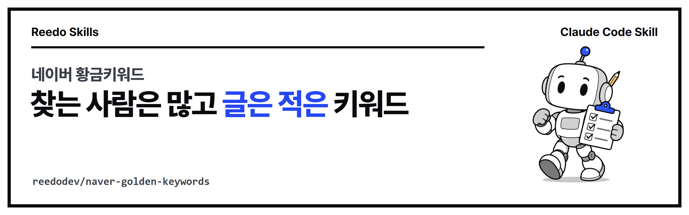

<p align="center"></p>

<p align="center">
<a href="https://github.com/reedodev/naver-golden-keywords/actions/workflows/test.yml"></a>


</p>

# 네이버 황금키워드 (naver-golden-keywords)

네이버 검색광고 API의 월간 검색량과 검색 API의 블로그 문서수로 경쟁률을 계산해 S·A·B 등급 황금키워드를 고르고, 연관 키워드까지 함께 채점합니다. 키 값은 화면에 출력하지 않습니다.

<!-- prereq-adapt -->
## 무엇이 필요한가요?

꼭 필요한 것은 Node 18 이상, 네이버 검색광고 계정과 API 키 3개, 네이버 개발자센터 앱(검색 API) 키 2개입니다. 권장·선택 준비물까지 정리한 표는 [SKILL.md의 준비물](skills/naver-golden-keywords/SKILL.md#준비물-쓰기-전에-있어야-하는-것)에 있습니다.

## 바꿔 쓰기

에이전트에게 다음처럼 말하면 옵션을 바꿔서 실행합니다.

- "검색량이 적어도 경쟁 없는 키워드를 보여 줘" → `--rules S:300:0.2,A:200:1,B:100:3` 처럼 등급 기준을 낮춥니다
- "등급 이름을 골드·실버로 해 줘" → `--rules 골드:30000:3,실버:10000:10`
- "연관 키워드도 같이 30개 봐 줘" → `--related 30`

말과 옵션의 대응표는 [SKILL.md의 바꿔 쓰기](skills/naver-golden-keywords/SKILL.md#바꿔-쓰기-이렇게-말하세요)에 있습니다.

## 설치

**Claude Code 플러그인으로 설치**

```
/plugin marketplace add reedodev/naver-golden-keywords
/plugin install naver-golden-keywords@naver-golden-keywords
```

**폴더만 복사**

```bash
git clone https://github.com/reedodev/naver-golden-keywords.git
cp -r naver-golden-keywords/skills/naver-golden-keywords ~/.claude/skills/
```

필요한 것: Node 18+, 네이버 검색광고·검색 API 키

## 바로 해 보기

```bash
node skills/naver-golden-keywords/scripts/golden-keywords.mjs 캠핑의자 --related 20 --csv result.csv
```

자세한 절차, 옵션, 한계는 [SKILL.md](skills/naver-golden-keywords/SKILL.md)에 있습니다. 에이전트가 이 파일을 읽고 그대로 따릅니다.

## 시험

`node tests/run.mjs`가 SKILL.md 형식을 검사하고 예시 파일로 스크립트를 실제로 실행합니다. 푸시할 때마다 GitHub Actions가 같은 시험을 돌립니다(위 test 배지).

<!-- credits -->
## 출처와 영감

- **데이터 출처**: 네이버 검색광고 API의 키워드 도구([공식 문서](https://naver.github.io/searchad-apidoc/))와 네이버 개발자센터 검색 API의 블로그 검색([공식 문서](https://developers.naver.com/docs/serviceapi/search/blog/blog.md))만 씁니다. 각 API의 이용 약관과 호출 한도를 따릅니다.
- **"황금키워드"라는 생각**: 검색량에 비해 글이 적은 키워드를 고르는 방식은 국내 블로거들 사이에서 널리 쓰이는 일반적인 방법입니다. S·A·B 등급 기준값은 작성자가 정한 것이고 `--rules`로 바꿀 수 있습니다.

## 만든 사람

**리도**, AI 좌충우돌 실습 중인 20년차 엔지니어입니다. 매일 AI에게 일을 맡기다가 막힌 부분을 고쳐 가며 이 스킬을 만들었습니다.
[YouTube @Reedodev](https://www.youtube.com/@Reedodev) · [Threads @reedo.dev](https://www.threads.com/@reedo.dev) · [GitHub @reedodev](https://github.com/reedodev)

같이 만든 다른 스킬: [옵시디언 3D 지식그래프](https://github.com/reedodev/obsidian-brain-3d) · [노트 먼저 찾아보기](https://github.com/reedodev/vault-recall) · [작업 기록 강의자료](https://github.com/reedodev/work-to-lecture-deck) · [한국어 말투 점검](https://github.com/reedodev/korean-tone-check) · [한글 양식 채우기](https://github.com/reedodev/hwpx-form-fill) · [TTS 끝소리 고치기](https://github.com/reedodev/tts-tail-fix) · [카드뉴스 렌더](https://github.com/reedodev/html-card-render) · [영상 비율 검사](https://github.com/reedodev/social-video-gate) · [유튜브 게시 점검](https://github.com/reedodev/youtube-publish-checklist)

---

## English

Score Naver blog keywords by monthly searches vs. blog document count using the official Search Ad and Search APIs, with related-keyword discovery and S/A/B grades.

**Credits.**
- Data comes only from the official Naver Search Ad API ([docs](https://naver.github.io/searchad-apidoc/)) and Naver Search API for blogs ([docs](https://developers.naver.com/docs/serviceapi/search/blog/blog.md)). The "golden keyword" idea is common practice among Korean bloggers; the grade thresholds are the author's own and configurable.

Install: `/plugin marketplace add reedodev/naver-golden-keywords` then `/plugin install naver-golden-keywords@naver-golden-keywords`, or copy `skills/naver-golden-keywords` into `~/.claude/skills/`. See [SKILL.md](skills/naver-golden-keywords/SKILL.md) for the full procedure. MIT License; third-party models, fonts and libraries keep their own licenses.
